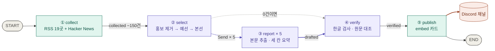

# 뉴스레터 에이전트

매일 아침 AI 기사 약 150건 중 개발팀이 알아야 할 **5건**을 골라 한국어로 요약해 **Discord 채널**에 올리는 LangGraph 에이전트.

## 어디에 올라가나

- **Discord 채널** — Secret `DISCORD_WEBHOOK_URL`(웹훅)이 연결된 채널. 보낸 사람 이름은 `편집실`.
- **매일 07:30 KST** — GitHub Actions가 실행. 몇 분~1시간 늦을 수 있음.
- 고를 기사가 없는 날에도 `오늘은 조용합니다` 한 장을 보내 살아 있음을 알림.

## 흐름



보라 = LLM 호출(gpt-4.1-mini) · 초록 = 코드만 · 점선 = 실행 중에 갈 곳을 고르는 조건부 엣지

| 노드 | 하는 일 |
|---|---|
| collect | 최근 24시간 글만, 같은 주소는 한 번. 응답 없는 소스·0건 소스는 로그에 이름을 남김 |
| select | 제목으로 투자·MOU·수상 기사 제거 → 최소 2조로 예선(조마다 8건) → 본선 5건. 같은 사건 1건, 매체당 2건까지 |
| report | `Send`로 기사마다 워커를 띄움. 본문 600자 미만은 제외, `headline · summary · why` 세 칸으로 요약 |
| verify | 한글이 없거나, 따로 부른 LLM이 원문과 대조해 근거가 없으면 버림 |
| publish | `DRY_RUN=1`(기본)이면 보내지 않음. Discord가 거절하면 실행을 실패로 끝냄 |

## 실행

```bash
python -m venv .venv && .venv/Scripts/pip install -r requirements.txt
```

`.env`에 두 값을 넣는다. (`.env`는 커밋하지 않는다)

```
OPENAI_API_KEY=sk-...
DISCORD_WEBHOOK_URL=https://discord.com/api/webhooks/...
```

```bash
python run.py --dry-run          # 보내지 않고 카드 내용만 출력
DRY_RUN=0 python run.py --silent # 알림 없이 실제 발행
DRY_RUN=0 python run.py          # 실제 발행
python run.py --delete <메시지ID> # 이 웹훅으로 보낸 메시지 삭제
```

**자동 실행** — 저장소 Settings → Secrets에 같은 두 값을 등록하면 `.github/workflows/daily.yml`이 매일 돈다. 손으로 돌리려면 Actions → 매일 브리핑 → Run workflow(`dry_run` 체크 시 발행 안 함).

## 기록

실행마다 `runs/날짜_시각.json`에 **왜 골랐는지**(선정 이유·사건 라벨·성격)와 **왜 떨어졌는지**(홍보 제거, 예선·본선 탈락, 같은 사건, 매체 상한), 발행한 기사를 남긴다. Actions에서는 실행 페이지의 artifact로 90일 보관.

## 파일

| 파일 | 내용 |
|---|---|
| `graph.py` | State, 노드 다섯 개, 그래프 |
| `run.py` | 진입점, 기록 저장 |
| `.github/workflows/daily.yml` | 매일 UTC 22:30 실행 |
