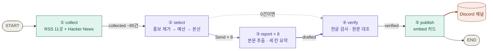

# 뉴스레터 에이전트

**브리핑 받아 보기 → Discord 채널 초대 링크: https://discord.gg/TjqctHFZJ**

올라오는 시각은 날마다 다르다. 07:30 정각에 오지 않고, 몇 시간 늦게 올라오는 날도 있다.

매일 아침 AI 기사 약 85건 중 개발팀이 알아야 할 **5건**을 골라 한국어로 요약해 **Discord 채널**에 올리는 LangGraph 에이전트.
과제 수행 보고서(독자 정의, 소스 채택표, 선별 설계, 실행 기록, 회고)는 [REPORT.md](REPORT.md)에 있다.

## 어디에 올라가나

- **Discord 채널** ([초대 링크](https://discord.gg/TjqctHFZJ)) — Secret `DISCORD_WEBHOOK_URL`(웹훅)이 연결된 채널. 보낸 사람 이름은 `편집실`.
- **매일 아침, 올라오는 시각은 정해져 있지 않다** — 07:30 정각에 오는 게 아니다. GitHub Actions에 KST 06:47·07:07·07:27 세 번 예약해 두고 먼저 시작한 한 번만 발행하는데, GitHub는 예약 실행을 제때 시작한다고 보장하지 않는다. 빠르면 06:50쯤, 늦으면 몇 시간 뒤(2026-10-29에는 10:55)에 올라온다.
- 고를 기사가 없는 날에도 `오늘은 조용합니다` 한 장을 보내 살아 있음을 알림.

## 흐름

보라 = LLM 호출(gpt-4.1-mini) · 초록 = 코드만 · 점선 = 실행 중에 갈 곳을 고르는 조건부 엣지

| 노드 | 하는 일 |
|---|---|
| collect | 최근 24시간 글만, 같은 주소는 한 번. 과제가 제외한 6개 매체 기사는 어느 경로로 들어와도 버림. 응답 없는 소스·0건 소스는 로그에 이름을 남김 |
| select | 최근 3일에 보낸 주소와 투자·MOU·수상 기사 제거 → 최소 2조로 예선(조마다 8건) → 본선 5건 + 예비 3건. 같은 사건 1건(라벨 비교 + LLM이 한 번 더 묶음, 최근 보낸 사건 포함), 매체당 2건까지 |
| report | `Send`로 기사마다 워커를 띄움(예비 포함 최대 8). 본문 600자 미만은 제외, `headline · summary · why` 세 칸으로 요약 |
| verify | 순위대로 검사해 5건이 차면 멈춤. 한글이 없거나, 따로 부른 LLM이 원문과 대조해 근거가 없으면 버리고 빈자리는 예비로 채움 |
| publish | `DRY_RUN=1`(기본)이면 보내지 않음. 429·5xx·연결 실패는 세 번까지 시도, 그래도 안 되면 실행을 실패로 끝냄 |

설치, 실행 명령, 자동 실행 설정, 실행 기록(`runs/`, `history.json`), 파일 구성은 [USAGE.md](USAGE.md)에 있다.

## 교안(D00 완전판)과 다른 점

노드 다섯 개, State 칸과 리듀서, 예선 → 본선 선별, 세 칸 요약, 따로 부른 LLM 검수, `DRY_RUN` 기본값, Actions 설정은 교안과 같다. 고친 곳은 `graph.py`에 `[고침]` 주석으로 표시했다.

| 노드 | 교안 | 이 저장소 |
|---|---|---|
| collect | 소스 약 11곳, 하루 50~120건 | 후보 31곳을 관문 3개 + AI 비율로 재서 고른 RSS 11곳 + Hacker News(30점 이상), 하루 약 85건 |
| | 연결 실패만 잡는다 | 403·404·500도 실패로 잡고, 0건인 소스도 로그에 남긴다 |
| | `?` 뒤를 모두 떼고 주소를 비교 | `utm_*` 등 추적용 꼬리표만 떼고, Atom의 `updated`도 읽는다 |
| select | 홍보성 기사는 프롬프트로 부탁 | 제목 정규식으로 먼저 거르고, `kind`가 투자·MOU·수상이나 로드맵·예고면 코드로 버린다 |
| | 제목만 보고, 모델이 답한 번호를 믿는다 | 요약도 보고, 모델이 옮겨 적은 제목으로 번호를 바로잡는다 |
| | 같은 사건은 라벨을 세자고 제안 | 라벨 형식을 강제해 유사도로 비교하고, LLM이 한 번 더 묶는다. 최근 3일 발행분(`history.json`)과도 비교한다 |
| | 5건 | 5건 + 예비 3건, 매체당 2건까지 |
| report | 워커 하나가 실패하면 전체가 멈춘다 | 실패한 기사만 빠진다. `topic` 칸을 더해 카드 색을 나눈다 |
| verify | 한글 검사를 연결하지 않았다 | 한글이 없으면 불합격. 순위대로 보고 빈자리는 예비로 채운다 |
| publish | Discord가 거절해도 실행은 성공 | 429·5xx는 세 번까지 다시 보내고, 그래도 안 되면 실행을 실패로 끝낸다 |
| | | `--silent`(알림 없이 발행), `--delete`(보낸 메시지 삭제) |
| | 기준이 코드 안 문자열 | 독자·기준·제외 조건을 `audience.yaml`로 뺐다 |
| 운영 | 실행 기록이 남지 않는다 | `runs/`에 선정·탈락 이유를 남기고 artifact로 90일 보관, 단계별 건수는 `store/metrics.jsonl`에 쌓아 커밋 |
| | 07:30에 한 번 예약 | 일찍 세 번 예약하고, 그날 먼저 보낸 한 번만 발행 (`last_sent.txt`) |
| | 60일 무커밋이면 예약 실행이 꺼진다 | 50일이 지나면 빈 커밋을 올린다. 패키지 버전은 `requirements.lock`으로 고정 |
| 그래프 | 선별 0건이면 publish가 돌지 않는다 | 0건이면 verify로 바로 가서 "오늘은 조용합니다"를 보낸다 |

교안 44장의 한계 중 아직 그대로인 것: 평가셋이 없고, 발행 전 사람 확인이 없고, 모든 단계가 같은 모델(`gpt-4.1-mini`)이다. 1차 소스를 경쟁 없이 올리는 tier 규칙(9장)도 넣지 않았다.
