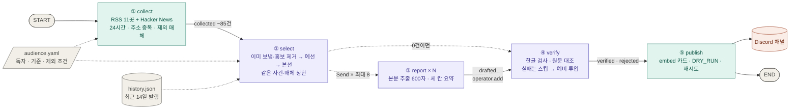
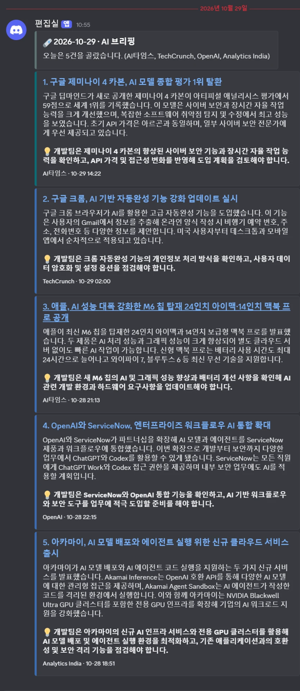

# 프로젝트 보고서 — AI 브리핑 뉴스레터 에이전트

- 저장소: https://github.com/rome777/newsletter-agent
- 받아 보기: Discord 채널 https://discord.gg/TjqctHFZJ
- 실행: GitHub Actions가 매일 아침 자동 실행 (KST 06:47·07:07·07:27 예약 중 먼저 시작한 한 번만 발행)

## 1. 분야 및 독자 정의

**분야: AI 기술 소식.** AI 기사는 하루 100건 가까이 쏟아지지만 대부분은 투자·행사·전망이다. 실제로 서비스를 운영하는 개발자에게 필요한 건 "지금 쓰는 모델·API·도구가 바뀌었는가"인데, 이걸 매일 직접 골라 읽기엔 시간이 없다. 그래서 그날 확인할 것 5건만 한국어로 받아 보는 브리핑을 만들었다.

**타깃 독자 페르소나** (`audience.yaml`의 `persona`)

> LLM API를 서비스에 붙여 운영하는 5~10명 규모 개발팀의 백엔드·ML 엔지니어.
> 출근길 5분 안에 오늘 확인할 것만 알고 싶다. 영어 기사도 읽지만 요약은 한국어로 받고 싶다.
> 투자·행사 소식보다 지금 쓰는 모델·API·도구가 바뀌었는지가 궁금하다.

이 페르소나에서 세 가지 설계가 나왔다.

| 페르소나 | 설계 |
|---|---|
| 5분 안에 | 하루 5건, 기사마다 헤드라인·세 문장 요약·"왜 중요한가" 한 줄 |
| 영어도 읽지만 요약은 한국어 | 소스는 영어·한국어를 섞고, 요약은 한국어로 강제(한글이 없으면 검수 불합격) |
| 투자·행사보다 도구 변화 | 홍보성 기사를 정규식과 성격 라벨로 두 번 거른다 |

독자·기준·제외 조건은 모두 `audience.yaml` 한 파일에 있다. 기준을 바꿀 때 코드를 열지 않는다.

## 2. 소스 채택표

### 기준
교안 10장의 관문 세 개에 주제 기준 하나를 더했다. 넷을 모두 넘어야 채택한다. 측정 스크립트는 `tools/measure_sources.py`, 원자료는 `store/sources.json`이다.

| 기준 | 측정 | 합격선 | 못 넘으면 생기는 일 |
|---|---|---|---|
| G1 본문 | 최근 기사 3건의 원문을 trafilatura로 추출 | 3건 중 2건 이상이 600자 초과 | 제목만 보고 요약을 지어낸다(환각) |
| G2 생존 | 최근 24시간 안의 글 수 | 1건 이상 | 매일 0건인데 요청 시간만 쓴다 |
| G3 접근 | 기사 페이지 응답 코드와 robots.txt | 200이고 robots.txt가 막지 않음 | 수집이 막히거나 허락받지 않은 수집이 된다 |
| 주제 | 피드 제목 중 AI 관련 낱말이 든 비율 | 30% 이상 | 종합 IT 피드가 후보를 AI와 무관한 기사로 채운다 |

과제가 제외한 6곳(OpenAI, DeepMind, TechCrunch, The Verge, MIT TR, AI타임스)은 비교를 위해 재기만 하고 쓰지 않는다. `audience.yaml`의 `excluded_domains`에 도메인을 적어 두고, 피드뿐 아니라 Hacker News가 이 매체 기사를 링크한 경우에도 수집 단계에서 버린다.

### 측정 결과 (2026-10-29 11:52 KST, 후보 31곳)

| 소스 | 언어 | 구분 | 피드 글 수 | 24시간 | 최신 글(시간 전) | AI 비율 | 본문 600자 초과 | 기사 접근 | 판정 |
|---|---|---|--:|--:|--:|--:|--:|---|---|
| OpenAI | 영 | 1차 | 1334 | 3 | 14 | 52% | 3/3 | 200 | 제외(과제) |
| DeepMind | 영 | 1차 | 100 | 1 | 10 | 62% | 3/3 | 200 | 제외(과제) |
| TechCrunch | 영 | 2차 | 20 | 13 | 5 | 45% | 3/3 | 200 | 제외(과제) |
| The Verge | 영 | 2차 | 10 | 9 | 4 | 40% | 3/3 | 200 | 제외(과제) |
| MIT TR | 영 | 2차 | 10 | 3 | 6 | 60% | 0/3 | 200 | 제외(과제) |
| AI타임스 | 한 | 2차 | 50 | 36 | -6 | 52% | 3/3 | 200 | 제외(과제) |
| Google AI | 영 | 1차 | 20 | 0 | 59 | 40% | 3/3 | 200 | 탈락(G2) |
| Google Research | 영 | 1차 | 100 | 0 | 33 | 53% | 3/3 | 200 | 탈락(G2) |
| Hugging Face | 영 | 1차 | 891 | 1 | 12 | 59% | 3/3 | 200 | **채택** |
| NVIDIA | 영 | 1차 | 18 | 1 | 12 | 67% | 3/3 | 200 | **채택** |
| AWS ML | 영 | 1차 | 20 | 3 | 8 | 75% | 3/3 | 200 | **채택** |
| Microsoft Research | 영 | 1차 | 10 | 0 | 155 | 40% | 3/3 | 200 | 탈락(G2) |
| LangChain | 영 | 1차 | 0 | 0 | — | 0% | 0/0 | — | 탈락(피드 없음) |
| Ars Technica | 영 | 2차 | 20 | 2 | 8 | 55% | 3/3 | 200 | **채택** |
| Wired | 영 | 2차 | 10 | 4 | 8 | 70% | 3/3 | 200 | **채택** |
| The Decoder | 영 | 2차 | 10 | 8 | 8 | 80% | 3/3 | 200 | **채택** |
| MarkTechPost | 영 | 2차 | 10 | 4 | 9 | 80% | 3/3 | 200 | **채택** |
| InfoQ | 영 | 2차 | 15 | 1 | 13 | 67% | 3/3 | 200 | **채택** |
| Simon Willison | 영 | 2차 | 30 | 4 | 4 | 13% | 3/3 | 200 | 탈락(주제) |
| ZDNet | 영 | 2차 | 25 | 10 | 6 | 24% | 3/3 | 200 | 탈락(주제) |
| SiliconANGLE | 영 | 2차 | 30 | 6 | 3 | 90% | 3/3 | 200 | **채택** |
| Analytics India | 영 | 2차 | 50 | 17 | 11 | 66% | 3/3 | 200 | **채택** |
| VentureBeat | 영 | 2차 | 0 | 0 | — | 0% | 0/0 | — | 탈락(피드 없음) |
| The Register | 영 | 2차 | 50 | 0 | 175 | 74% | 3/3 | 200 · robots 금지 | 탈락(G2·G3) |
| GeekNews | 한 | 2차 | 50 | 47 | 0 | 26% | 0/3 | 403 | 탈락(G1·G3·주제) |
| ZDNet Korea | 한 | 2차 | 30 | 30 | 1 | 17% | 3/3 | 200 | 탈락(주제) |
| 전자신문 | 한 | 2차 | 30 | 30 | 1 | 13% | 3/3 | 200 | 탈락(주제) |
| 인공지능신문 | 한 | 2차 | 50 | 27 | -9 | 64% | 3/3 | 200 | **채택** |
| 바이라인네트워크 | 한 | 2차 | 20 | 10 | 1 | 25% | 3/3 | 200 | 탈락(주제) |
| 블로터 | 한 | 2차 | 50 | 50 | -9 | 4% | 3/3 | 200 | 탈락(주제) |
| 요즘IT | 한 | 2차 | 30 | 0 | — | 33% | 3/3 | 200 | 탈락(G2) |

**채택 11곳 + Hacker News 공개 API.** 하루 약 85건이 들어온다(10-29 dry-run 86건).

- **Hacker News**는 RSS가 아니라 공개 API(교안 7장 사다리 ①칸)로 가져온다. 30점 이상인 AI 관련 글만 받는다.
- **한국어 소스**: 제외된 AI타임스를 대신할 곳을 6곳 쟀다. 종합 IT 매체(ZDNet Korea, 전자신문, 블로터 등)는 하루 30~50건을 주지만 AI 기사 비율이 4~25%라 탈락했다. AI 전문지인 인공지능신문(64%)만 남았다.
- **GeekNews**는 피드는 열리지만 기사 페이지가 403이라 본문을 뽑을 수 없다(G1·G3).
- **Google AI**는 10-28~29 로컬 실행 16회와 10-29 Actions 예약 실행에서 모두 24시간 안의 글이 0건이었다(실행 로그 `0건 ['Google AI']`). 측정에서도 마지막 글이 59시간 전이라 G2에서 뺐다.
- **최신 글이 음수**(AI타임스 -6, 인공지능신문 -9)인 것은 이 매체들이 한국 시각을 UTC로 표기해 9시간 앞서 보이기 때문이다. 오류가 아니라 발행 관행이다.
- **AI 비율의 한계**: 제목 낱말로만 세서 ZDNet의 AI 토픽 피드(24%)처럼 실제로는 AI 기사인데 제목에 낱말이 없는 경우를 놓친다. 한 번 잰 값이라 날마다 달라질 수 있다.

## 3. 선별 로직 설계

### 중요도 판단 문장
선별 프롬프트 맨 앞에 그대로 들어간다(`audience.yaml`).

```
독자는 AI를 실제 제품에 붙이는 국내 개발팀입니다.
고를 것:
- 이번 주 일하는 방식이 바뀔 만한가
- 지금 쓰는 도구·API의 가격·한도·정책이 실제로 변했나
버릴 것 (절대 고르지 마세요):
- 발표 예정·로드맵·예고만 있고 지금 쓸 수 있는 게 없는 소식
- 투자 유치·펀딩·기업 가치·MOU·제휴 체결·수상 같은 홍보성 소식
```

### 흐름
```
수집 약 85건
 → 최근 3일 안에 보낸 주소 제외        (history.json)
 → 홍보성 제목 제외                    (정규식 19개, audience.yaml)
 → 예선: 묶음마다 8건                  (LLM, 구조화된 출력 Pick)
 → 성격(kind)이 로드맵·예고 / 투자·MOU·수상이면 버림   (코드)
 → 본선: 5건 + 예비 3건                (LLM)
 → 같은 사건 1건만 · 매체당 2건까지     (라벨 비교 + LLM 묶기 + 최근 발행과 비교)
```

### 예선/본선 2단계를 쓴 이유
- **기사마다 따로 점수를 매기면** 점수가 몇 개 값에 몰려 다섯 번째 자리에서 동점이 생긴다. "몇 점인가"가 아니라 "오늘 것 중 무엇이 위인가"를 물어야 한다(교안 15장).
- **85건을 한 프롬프트에 넣으면** 모델이 목록 가운데를 흘린다(lost in the middle).
- 그래서 묶음끼리는 따로(예선), 살아남은 것끼리는 한 화면에서(본선) 비교한다.

### 숫자를 정한 이유
| 값 | 설정 | 이유 |
|---|---|---|
| 묶음 크기 | 최대 40건, 최소 2묶음 | 40건이면 제목+요약 200자 목록이 한 화면에 들어가 중간 누락이 적다. 후보가 적은 날도 묶음을 둘 이상 만들어 예선을 반드시 치른다 |
| 묶음당 통과 | 8건 | 최종 5건보다 넉넉히 올려 "묶음 운"(강한 묶음의 9등이 약한 묶음의 3등보다 나아도 떨어지는 문제)을 줄인다. 85건이면 3묶음 × 8 = 24건이 본선에 올라 발행 비율 5/24 ≈ 0.2 |
| 묶음 섞기 | 날짜 시드로 섞어 나눔 | 같은 소스가 한 묶음에 몰리지 않게 |
| 본선 | 5건 + 예비 3건 | 검수에서 빠지면 예비로 채워 과제 기준(3~5건)을 지킨다 |
| 매체 상한 | 2건 | 하루 27건을 내는 인공지능신문이 브리핑을 독차지하지 않게 |

### 기준이 의도대로 동작했다는 근거
실행마다 `runs/날짜_시각.json`에 기사별 판정을 남기고, 마지막 회차는 `store/last_run.json`, 단계별 건수는 `store/metrics.jsonl`에 쌓는다. 아래는 2026-10-29 11:57 dry-run의 본선 기록(`store/last_run.json` → `selection.final`)이다.

| 판정 | 매체 | 기사 | 성격(kind) | 사건 라벨(event) |
|---|---|---|---|---|
| 최근 발행 | 인공지능신문 | 애플, M6 맥북 프로 공개 | 출시·변경 | apple-m6-macbook-pro |
| 선정 | 인공지능신문 | 엔비디아, GPU 메모리 공유 기술 공개 | 출시·변경 | nvidia-gpu-sharing |
| 매체 상한 | 인공지능신문 | KT, AI 고객센터 월 120만 건 처리 | 출시·변경 | kt-ai-contact-center |
| 선정 | SiliconANGLE | Nvidia Nemotron 3.5 공개 | 출시·변경 | nvidia-nemotron-3.5 |
| 선정 | Analytics India | GitHub Copilot Fusion 출시 | 출시·변경 | github-copilot-fusion |
| 같은 사건 | The Decoder | Nvidia Nemotron 3.5 Transcribe | 출시·변경 | nvidia-nemotron-3.5 |
| 예비 | AWS ML | Ray Train DLC 분산 학습 | 출시·변경 | ray-train-distributed-training |

- **최근 발행**: 애플 M6 기사는 전날 AI타임스 기사로 이미 보낸 사건이라 빠졌다(`history.json`과 비교).
- **같은 사건**: Nemotron 3.5를 다룬 두 매체 기사 중 하나만 남았다.
- **매체 상한**: 인공지능신문은 2건이 차자 나머지가 빠졌다.
- **홍보 제외**: 같은 회차에 "IIIT Hyderabad and NPCI Sign MoU…", "Live2.ai Raises ₹130 Cr in Pre-Series B…"가 LLM에 넘어가기 전에 정규식으로 빠졌다(`selection.promo`).

## 4. 파이프라인 구조도



보라 = LLM 호출(gpt-4.1-mini, temperature 0) · 초록 = 코드만 · 점선 화살표 = 실행 중에 갈 곳을 고르는 조건부 엣지

### State
| 칸 | 쓰는 노드 | 합치는 법 | 내용 |
|---|---|---|---|
| `hours` | — | 설정값 | 수집 시간 범위(24) |
| `collected` | collect | 덮어쓰기 | 모은 기사 |
| `picked` | select | 덮어쓰기 | 본선 통과 5건 + 예비, 순위(`rank`) 포함 |
| `trace` | select | 덮어쓰기 | 왜 골랐고 왜 떨어졌는지 |
| `drafted` | report × N | **이어 붙이기** (`operator.add`) | 워커마다 한 건씩 |
| `verified` | verify | 덮어쓰기 | 검수 통과분 |
| `rejected` | verify | 덮어쓰기 | 검수 불합격분과 이유 |
| `sent` | publish | 덮어쓰기 | sent · dry-run · failed |
| `log` | 전부 | **이어 붙이기** | 실행 로그 |

### 검수와 예외 처리
| 상황 | 대응 |
|---|---|
| 본문이 600자 미만 | 요약하지 않고 빼서, 제목만 보고 지어내지 않게 한다 |
| 요약에 한글이 없음 | 불합격(모델이 영어 기사 앞에서 한국어 지시를 무시하는 경우) |
| 따로 부른 LLM이 원문과 대조해 근거 없음 판정 | 불합격, `rejected`에 문제 문장을 남긴다 |
| 불합격·추출 실패 | **스킵하고 예비로 채운다.** 재생성은 비용·재시도 한도·무한 반복 문제가 따라와서 쓰지 않았다(교안 30장) |
| 워커·검수 호출 예외 | 그 기사만 빠지고 나머지는 계속 |
| 선별 0건 | verify로 바로 가서 "오늘은 조용합니다" 한 장을 보낸다(heartbeat) |
| Discord 429·5xx·연결 실패 | 세 번까지 다시 보낸다. 그래도 안 되면 실행을 실패로 끝내 GitHub가 메일을 보낸다 |
| 예약 실행 지연 | 세 번 예약하고, 그날 이미 보냈으면(`last_sent.txt`) 건너뛴다 |

## 5. 실행 기록

### Discord 발행 화면 (2026-10-29 10:55, GitHub Actions 예약 실행)



이 회차의 Actions 로그(run 40803207745):

```
① 수집   24시간 time window · 136건 · 소스 20곳 · 0건 ['Google AI']
② 선별   136 → 이미 보냄 제외 134 → 홍보 제외 129 → 예선 4조 32 → 5건 + 예비 3 · 같은 사건 5 · 최근 발행 1
④ 검수   8 → 5건 · 불합격 ['Analytics India'] · 예비 투입 1
⑤ 발행   5건 · sent
```

검수에서 1건이 떨어졌고 예비 1건이 그 자리를 채워 5건이 그대로 나갔다. 다만 이 회차는 과제 조건을 반영하기 **전**이라 제외 소스(AI타임스, TechCrunch, OpenAI)가 들어 있다. 이 문제를 찾아 소스를 다시 고른 과정은 2절과 6절에 있다.

### 소스를 바꾼 뒤 (2026-10-29 11:57, 로컬 dry-run)

```
① 수집   24시간 time window · 86건 · 소스 12곳
② 선별   86 → 이미 보냄 제외 84 → 홍보 제외 82 → 예선 3조 24 → 5건 + 예비 3 · 최근 발행 1 · 같은 사건 1
④ 검수   8 → 5건
⑤ 발행   5건 · dry-run
```

`store/metrics.jsonl`에는 실행마다 아래처럼 한 줄이 쌓인다(줄임).

```json
{"at": "2026-10-29T11:57:43", "trigger": "local", "sent": "dry-run", "seconds": 65, "collected": 86,
 "per_source": {"인공지능신문": 27, "Analytics India": 17, "Hacker News": 12, "The Decoder": 8, ...},
 "already_sent": 2, "promo_dropped": 2, "heats": [28, 27, 27], "heat_passed": 24, "same_event_dropped": 2,
 "picked": 8, "drafted": 8, "body_ok_rate": 1.0, "verify_failed": [], "published": 5, ...}
```

## 6. 프로젝트 회고

### 가장 공들인 부분
1. **"조용한 실패"를 하나씩 드러낸 것.** 교안 코드는 돌아가지만 틀린 결과를 조용히 내는 곳이 많았다. 다음은 모두 실제로 돌려 보다가 찾아 고친 것이다(`graph.py`의 `[고침]` 주석).
   - 403·404를 받아도 수집 실패로 잡지 않았다.
   - Discord가 거절해도 실행이 성공으로 끝났다.
   - 선별이 0건이면 heartbeat도 끊겼다.
   - 모델이 긴 목록에서 번호를 틀려 이유가 엉뚱한 기사에 붙었다. 제목을 옮겨 적게 해 바로잡았다.
   - 영어 목록 앞에서 선정 이유를 영어로 썼다.
2. **선별 근거를 남기는 것.** 결과 5건만 보면 선별이 잘 됐는지 알 수 없다. 그래서 떨어진 기사와 이유(홍보, 예선·본선 탈락, 같은 사건, 최근 발행, 매체 상한, 검수 불합격)를 전부 기록한다.
3. **같은 사건 거르기.** 라벨 비교, LLM 묶기, 최근 3일 발행 이력의 세 겹으로 만들었다. 오늘도 라벨 비교의 허점을 하나 찾았다. 모델이 `product-update`처럼 회사 이름 없는 라벨을 붙이면 전혀 다른 기사(Gemini 4 Carbon과 Airbnb 추천 개선)가 같은 사건으로 묶여 빠졌다. 그래서 일반 낱말만 남는 라벨은 비교하지 않게 고쳤다. 그런데 필드 설명에 "product-update 같은 라벨은 쓰지 마라"라고 적자, 모델이 오히려 모든 기사에 그 라벨을 붙였다. 피해야 할 예를 들면 그 예를 따라 한다는 것을 배웠고, 좋은 예만 보여 주도록 바꿨다.
4. **운영.** GitHub Actions 예약 실행이 07:30이 아니라 10:54에 시작된 날이 있었다. 그래서 세 번 예약하고 하루 한 번만 발행하게 했다. 실행이 겹치지 않게 막고, 뒤 실행이 앞 실행의 기록을 보도록 최신 main을 받게 했다.

### 놓쳤던 것
과제의 제외 소스 목록을 늦게 확인해, 처음 이틀 동안은 제외 대상 5곳(OpenAI, DeepMind, TechCrunch, The Verge, AI타임스)을 수집하고 있었다. 실제 발행분의 절반 이상이 AI타임스·TechCrunch·OpenAI에서 왔다. 후보 31곳을 다시 재서 소스를 고르고, 제외 도메인은 코드에서 막아 다시 들어오지 못하게 했다.

### 향후 보완
- **평가셋이 없다.** 프롬프트를 바꿀 때 몇 건을 눈으로 보고 판단했다. 하루치 후보와 "사람이 골랐을 5건"을 고정해 두고 바꾸기 전후를 비교하고 싶다.
- **발행 전 사람 확인이 없다.** 검수를 통과하면 그대로 나간다. `--delete`로 보낸 뒤에 지울 수만 있다.
- **모든 단계가 같은 모델이다.** 검수는 요약과 다른 모델로 부르면 같은 실수를 같이 놓칠 가능성이 줄어든다.
- **소스 측정을 한 번만 했다.** G2·주제 비율은 날마다 달라진다. 측정 스크립트를 주 1회 돌려 `store/sources.json`을 쌓고 싶다.
- **라벨이 한쪽으로 몰린다.** 10-29 dry-run에서 발행 5건이 모두 성격 "출시·변경", 토픽 "도구·프레임워크"였다. 이래서는 라벨로 기사를 갈라 볼 수 없고 카드 색도 하나로 나온다. 라벨 정의를 더 구체적으로 써야 한다.
- **한국어 소스가 하나뿐이다.** 종합 IT 매체의 AI 섹션 피드를 찾으면 주제 기준을 넘을 수 있다.
