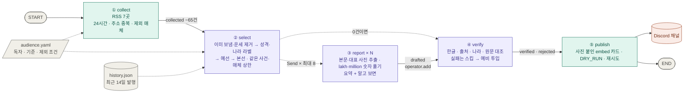
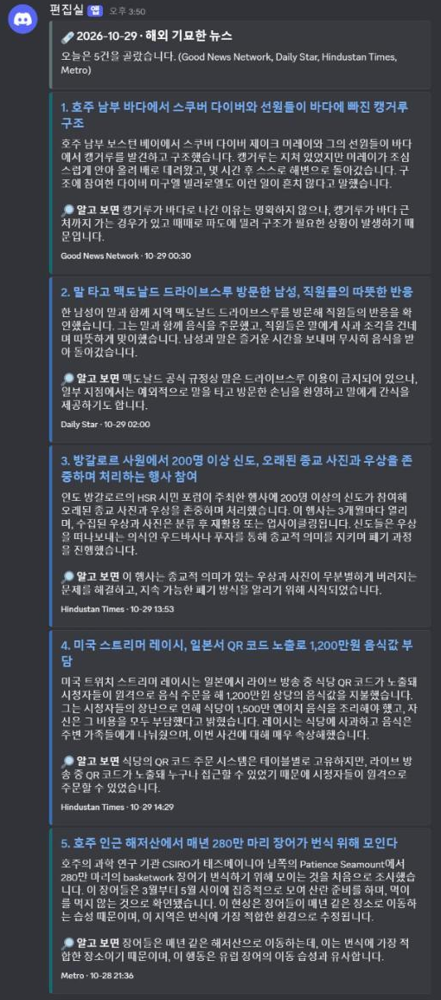
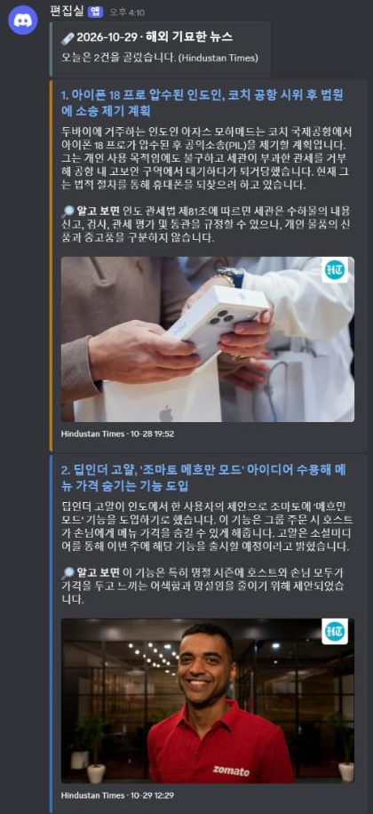

# 프로젝트 보고서 — 해외 기묘한 뉴스 에이전트

- 저장소: https://github.com/rome777/newsletter-agent
- 받아 보기: Discord 채널 https://discord.gg/TjqctHFZJ
- 실행: GitHub Actions가 매일 아침 자동 실행 (KST 06:47·07:07·07:27 예약 중 먼저 시작한 한 번만 발행)

## 1. 분야 및 독자 정의

**분야: 해외 기묘한 뉴스.** 영국 타블로이드의 Weird 섹션이나 인도 매체의 Trending 섹션에는 "실제로 있었던 이상한 이야기"가 매일 올라온다. 다만 영어이고, 같은 피드에 사건 사고·연예 가십·운세·광고가 섞여 있다. 그중 점심시간에 가볍게 읽고 남에게 말해 줄 만한 이야기 5건만 골라 한국어로 받아 보는 뉴스레터를 만들었다.

**타깃 독자 페르소나** (`audience.yaml`의 `persona`)

> 점심시간이나 퇴근길 5분 동안 가볍게 읽을 이야기를 찾는 20~30대 직장인.
> 정치·사건 사고 뉴스는 피곤하고, 동료나 친구에게 "이거 봤어?" 하고 꺼낼 만한 해외 이야기를 원한다.
> 영어 기사는 잘 안 읽어서 요약은 한국어로 받고 싶다. 지어낸 이야기나 낚시 기사는 싫다.

페르소나의 문장마다 설계가 하나씩 따라 나왔다.

| 페르소나 | 설계 |
|---|---|
| 5분 동안 가볍게 | 하루 5건, 기사마다 헤드라인 · 세 문장 요약 · 원문에서 찾은 "알고 보면" 한 줄 · 원문 대표 사진 |
| 정치·사건 사고는 피곤 | 성격 라벨이 비극·범죄, 일반 뉴스, 연예·운세·쇼핑이면 코드로 버린다 |
| 해외 이야기 | 사건이 일어난 나라를 라벨로 받고, 검수에서 본문을 읽고 한 번 더 확인해 한국이면 버린다 |
| 요약은 한국어로 | 요약을 한국어로 강제하고, 한글이 없으면 검수 불합격 |
| 지어낸 이야기·낚시는 싫다 | 검수에서 출처가 드러난 실제 사건 보도인지 따로 판정하고, '충격·경악' 같은 표현을 금지한다 |

독자·기준·제외 조건은 모두 `audience.yaml` 한 파일에 있다. 기준을 바꿀 때 코드를 열지 않는다.

## 2. 소스 채택표

### 기준
교안 10장의 관문 세 개에 주제 기준 하나를 더했다. 넷을 모두 넘어야 채택한다. 측정 스크립트는 `tools/measure_sources.py`, 원자료는 `store/sources.json`이다.

| 기준 | 측정 | 합격선 | 못 넘으면 생기는 일 |
|---|---|---|---|
| G1 본문 | 최근 기사 3건의 원문을 trafilatura로 추출 | 3건 중 2건 이상이 600자 초과 | 제목만 보고 요약을 지어낸다(환각) |
| G2 생존 | 최근 24시간 안의 글 수 | 1건 이상 | 매일 0건인데 요청 시간만 쓴다 |
| G3 접근 | 기사 페이지 응답 코드와 robots.txt | 200이고 robots.txt가 막지 않음 | 수집이 막히거나 허락받지 않은 수집이 된다 |
| 주제 | 피드 제목 최대 30개를 LLM이 하나씩 "해외에서 실제로 일어난 기묘한 사건인가"로 판정한 비율 | 30% 이상 | 국제면 피드가 후보를 정치·사고 뉴스로 채운다 |

주제 기준은 처음에 50%로 잡았다가 30%로 낮췄다. 같은 출판사의 Weird 섹션끼리도 Daily Star 52%, Mirror 28%로 갈릴 만큼 LLM 판정이 흔들렸기 때문이다. 기묘하지 않은 기사는 선별 단계의 라벨에서 한 번 더 걸러진다. 30%는 AI 브리핑으로 만들 때 쓰던 주제 기준선과 같다.

과제가 제외한 6곳(OpenAI, DeepMind, TechCrunch, The Verge, MIT TR, AI타임스)은 표에 함께 쟀지만 쓰지 않는다. `audience.yaml`의 `excluded_domains`에 도메인을 적어 두고, 어느 피드를 거쳐 들어와도 수집 단계에서 버린다.

### 측정 결과 (2026-10-29 14:12 KST, 후보 38곳)

| 소스 | 언어 | 구분 | 피드 글 수 | 24시간 | 최신 글(시간 전) | 기묘 비율 | 본문 600자 초과 | 기사 접근 | 판정 |
|---|---|---|--:|--:|--:|--:|--:|---|---|
| OpenAI | 영 | 제외 | 1334 | 3 | 16 | 0% | 3/3 | 200 | 제외(과제) |
| DeepMind | 영 | 제외 | 100 | 1 | 12 | 0% | 3/3 | 200 | 제외(과제) |
| TechCrunch | 영 | 제외 | 20 | 13 | 7 | 0% | 3/3 | 200 | 제외(과제) |
| The Verge | 영 | 제외 | 10 | 9 | 6 | 20% | 3/3 | 200 | 제외(과제) |
| MIT TR | 영 | 제외 | 10 | 3 | 9 | 0% | 0/3 | 200 | 제외(과제) |
| AI타임스 | 한 | 제외 | 50 | 44 | -9 | 3% | 3/3 | 200 | 제외(과제) |
| UPI Odd News | 영 | 전용 | 25 | 5 | 12 | 72% | 0/3 | 403 | 탈락(G1·G3) |
| Sky News Strange | 영 | 전용 | 4 | 1 | 21 | 75% | 0/3 | 403 | 탈락(G1·G3) |
| Mirror Weird | 영 | 전용 | 25 | 4 | 18 | 28% | 3/3 | 200 | 탈락(주제) |
| Daily Star Weird | 영 | 전용 | 25 | 4 | 12 | 52% | 3/3 | 200 | **채택** |
| Metro Weird | 영 | 전용 | 22 | 2 | 16 | 64% | 3/3 | 200 | **채택** |
| Express Weird | 영 | 전용 | 10 | 0 | 497 | 30% | 3/3 | 200 | 탈락(G2) |
| CBC Offbeat | 영 | 전용 | 20 | 0 | 74537 | 85% | 0/3 | 200 | 탈락(G1·G2) |
| Global News Odd | 영 | 전용 | 10 | 0 | 41456 | 100% | 3/3 | 200 | 탈락(G2) |
| NY Post Weird | 영 | 전용 | 0 | 0 | — | 0% | 0/0 | — | 탈락(피드 없음) |
| Oddity Central | 영 | 전용 | 0 | 0 | — | 0% | 0/0 | — | 탈락(피드 없음) |
| SoraNews24 | 영 | 전용 | 20 | 4 | 1 | 10% | 3/3 | 200 | 탈락(주제) |
| NPR Strange News | 영 | 전용 | 10 | 0 | 704 | 70% | 3/3 | 200 | 탈락(G2) |
| Irish Mirror Weird | 영 | 전용 | 1 | 1 | 23 | 0% | 1/1 | 200 | 탈락(G1·주제) |
| HT Trending | 영 | 화제 | 38 | 19 | 0 | 30% | 3/3 | 200 | **채택** |
| Indian Express Trending | 영 | 화제 | 200 | 4 | 0 | 70% | 3/3 | 200 | **채택** |
| Mothership | 영 | 화제 | 10 | 10 | 11 | 0% | 3/3 | 200 | 탈락(주제) |
| SCMP Trending China | 영 | 화제 | 50 | 3 | 8 | 0% | 3/3 | 200 | 탈락(주제) |
| Vice | 영 | 화제 | 10 | 10 | 1 | 30% | 3/3 | 200 | **채택** |
| Atlas Obscura | 영 | 잡학 | 27 | 4 | 9 | 0% | 3/3 | 200 | 탈락(주제) |
| Boing Boing | 영 | 잡학 | 30 | 14 | 6 | 43% | 0/3 | 403 | 탈락(G1·G3) |
| Bored Panda | 영 | 잡학 | 10 | 10 | 1 | 0% | 2/3 | 200 | 탈락(주제) |
| Mental Floss | 영 | 잡학 | 81 | 8 | 5 | 0% | 3/3 | 200 | 탈락(주제) |
| Good News Network | 영 | 잡학 | 50 | 5 | 11 | 47% | 3/3 | 200 | **채택** |
| Fark | 영 | 모음 | 50 | 50 | 0 | 57% | 0/3 | 403 | 탈락(G1·G3) |
| Reddit r/offbeat | 영 | 모음 | 5 | 5 | 8 | 80% | 0/3 | 200 · robots 금지 | 탈락(G1·G3) |
| Reddit r/nottheonion | 영 | 모음 | 0 | 0 | — | 0% | 0/0 | — | 탈락(피드 없음, 429) |
| 서울신문 국제 | 한 | 종합 | 25 | 21 | 2 | 40% | 3/3 | 200 | **채택** |
| 연합뉴스 국제 | 한 | 종합 | 120 | 120 | 0 | 0% | 3/3 | 200 | 탈락(주제) |
| 뉴시스 국제 | 한 | 종합 | 100 | 100 | 0 | 3% | 3/3 | 200 | 탈락(주제) |
| 동아일보 국제 | 한 | 종합 | 50 | 50 | 2 | 10% | 3/3 | 200 | 탈락(주제) |
| 국민일보 국제 | 한 | 종합 | 100 | 36 | -10 | 10% | 3/3 | 200 | 탈락(주제) |
| 경향신문 국제 | 한 | 종합 | 50 | 25 | 3 | 0% | 3/3 | 200 | 탈락(주제) |

**채택 7곳.** 하루 약 65건이 들어온다(10-29 실행 64~66건). 단 Indian Express는 GitHub Actions에서 응답하지 않은 날이 있다(5절).

- **기묘한 뉴스 전용 피드는 기사 페이지를 막은 곳이 많다.** UPI, Sky News, Boing Boing은 피드는 열리지만 기사 페이지가 우리 수집기에 403을 돌려준다. 브라우저인 척해서 우회하지 않고 G3 탈락으로 처리했다.
- **링크 모음(Fark, Reddit)은 원문이 아니라 댓글 페이지로 링크한다.** 그래서 본문이 뽑히지 않는다(G1). Fark의 원문 이동 링크(`/go/`)도 403이고, Reddit은 robots.txt가 막는다.
- **오래 멈춘 피드가 많다.** CBC Offbeat, Global News, NPR, Express는 피드는 열리지만 마지막 글이 몇 주에서 몇 년 전이다(G2).
- **한국어 해외 화제 전용 RSS는 찾지 못했다.** 서울신문 나우뉴스, 뉴스1 해외토픽 등은 피드가 없거나 비어 있었다. 국제면 6곳 중에서는 '월드픽' 연재가 있는 서울신문만 30%를 넘었다. 서울신문 국제 피드에는 국내 기사도 섞여 있어(10-29 기준 22건 중 14건이 나라 라벨 '한국') 선별 단계에서 거른다.
- **최신 글이 음수**(AI타임스, 국민일보)인 것은 한국 시각을 UTC로 표기해 9시간 앞서 보이기 때문이다.
- **기묘 비율의 한계**: 제목만 보고 LLM이 판정하고, 한 번 잰 값이다. 같은 성격의 섹션끼리도 판정이 갈렸다(위 Mirror·Daily Star).

## 3. 선별 로직 설계

### 중요도 판단 문장
선별 프롬프트 맨 앞에 그대로 들어간다(`audience.yaml`).

```
독자는 점심시간에 가볍게 읽을거리를 찾는 국내 20~30대 직장인입니다.
고를 것:
- 실제로 일어난 일인데 처음 들으면 "진짜?" 소리가 나오는가
- 웃기거나 신기하거나 훈훈해서 남에게 말해 주고 싶은가
- 누가, 어디서, 무엇을 했는지 기사에 분명히 나오는가
버릴 것 (절대 고르지 마세요):
- 사망·중상·성범죄·학대처럼 피해자가 있는 비극을 흥밋거리로 다룬 기사
- 정치·전쟁·재난·경제, 기업 발표·기술 소식, 인터뷰·조언 같은 일반 뉴스
- 연예인 가십, 운세·퀴즈·쇼핑·할인 콘텐츠
- 출처가 불분명한 소문, 풍자 기사, SNS 글 하나만 옮긴 기사
- 한국 국내에서 일어난 일
```

### 흐름
```
수집 약 65건
 → 최근 3일 안에 보낸 주소 제외                       (history.json)
 → 운세·퀴즈·할인 제목 제외                            (정규식 14개, audience.yaml)
 → 성격(kind)·나라(country) 라벨                       (LLM, 순위 매기기와 따로 부른다)
     비극·범죄 / 일반 뉴스 / 연예·운세·쇼핑 / 한국이면 버림   (코드)
 → 예선: 묶음마다 최대 8건                             (LLM, 구조화된 출력 Pick)
 → 본선: 5건 + 예비 3건                                (LLM)
 → 같은 사건 1건만 · 매체당 2건까지 · 사건 라벨이 한국 지명이면 버림
```

### 라벨을 순위와 따로 붙이는 이유
처음에는 예선·본선에서 기사를 고르면서 성격 라벨도 같이 받았다. 그러자 회차마다 결과가 크게 흔들렸다. 어느 회차는 본선에서 캥거루 구조, 장어 떼, 말 탄 남성까지 10건을 '일반 뉴스'로 분류해 버렸다. 고르는 일과 분류하는 일을 한 호출에 섞었고, 예선에서 이미 분류한 기사를 본선에서 다시 분류했기 때문이다. 지금은 후보마다 분류만 하는 호출을 한 번 따로 부른다. 같은 후보 65건을 두 번 분류했을 때 60건(92%)이 같았다.

나라도 처음에는 `in_korea` 참/거짓으로 물었다. 그러자 인도 기사에 true를 붙이는 일이 잦았다. 그래서 나라 이름을 영어로 받아 코드에서 한국인지 비교한다.

### 예선/본선 2단계를 쓴 이유
- **기사마다 따로 점수를 매기면** 점수가 몇 개 값에 몰려 다섯 번째 자리에서 동점이 생긴다. "몇 점인가"가 아니라 "오늘 것 중 무엇이 위인가"를 물어야 한다(교안 15장).
- **후보를 한 프롬프트에 모두 넣으면** 모델이 목록 가운데를 흘린다(lost in the middle).
- 그래서 묶음끼리는 따로(예선), 살아남은 것끼리는 한 화면에서(본선) 비교한다.

### 숫자를 정한 이유
| 값 | 설정 | 이유 |
|---|---|---|
| 묶음 크기 | 최대 40건, 최소 2묶음 | 40건이면 제목+요약 200자 목록이 한 화면에 들어가 중간 누락이 적다. 후보가 적은 날도 묶음을 둘 이상 만들어 예선을 반드시 치른다 |
| 묶음당 통과 | 8건, 작은 묶음은 절반(최소 5건) | 라벨에서 많이 빠진 날 9건짜리 묶음에서 8건이 통과해 예선이 사실상 고르지 않았다. 지금은 9건이면 5건만 올린다 |
| 묶음 섞기 | 날짜 시드로 섞어 나눔 | 같은 소스가 한 묶음에 몰리지 않게 |
| 본선 | 5건 + 예비 3건 | 검수에서 빠지면 예비로 채워 과제 기준(3~5건)을 지킨다 |
| 매체 상한 | 2건 | 하루 19건을 내는 Hindustan Times가 브리핑을 독차지하지 않게 |

### 기준이 의도대로 동작했다는 근거
실행마다 `runs/날짜_시각.json`에 기사별 판정을 남기고, 마지막 회차는 `store/last_run.json`, 단계별 건수와 라벨 분포는 `store/metrics.jsonl`에 쌓는다. 아래는 실제로 발행한 2026-10-29 15:50 회차(GitHub Actions run 40831568495)의 기록이다. `store/last_run.json`은 다음 실행이 덮어쓰므로, 이 회차는 [`docs/evidence/run_2026-10-29_1550.json`](docs/evidence/run_2026-10-29_1550.json)에 그대로 복사해 두었다.

**단계별 건수**: 수집 64 → 운세 제외 63 → 라벨 제외 22 → 예선 2조(11·11) 10 → 본선 5건 + 예비 2

**성격 라벨 분포(63건)**: 일반 뉴스 20 · 비극·범죄 14 · 사람·도전 13 · 법·행정 7 · 발견·장소 4 · 동물 4 · 연예·운세·쇼핑 1. 일반 뉴스·비극·범죄·연예 35건에 나라가 한국인 6건을 더해 41건이 예선 전에 빠졌다(`selection.label_dropped`).

| 라벨에서 빠진 기사 (일부) | 매체 | 판정 |
|---|---|---|
| Microsoft offered buyouts to 60,000 employees… | Hindustan Times | 일반 뉴스 |
| Elon Musk's AI Grok unveils first 'Odyssey' chapter… | Hindustan Times | 일반 뉴스 |
| Keralam police officer booked for stealing lost Redmi phone… | Hindustan Times | 비극·범죄 |
| Stranger Anonymously Pays $420 Lunch Tab for 27 Disabled Residents… | Good News Network | 국내 (인천에서 일어난 일) |

본선 기록(`selection.final`):

| 판정 | 매체 | 기사 | 성격(kind) | 사건 라벨(event) |
|---|---|---|---|---|
| 선정 | Good News Network | 바다 한가운데서 캥거루 구조 | 동물 | australia-kangaroo-sea-rescue |
| 선정 | Daily Star | 말 타고 맥도날드 드라이브스루 | 사람·도전 | uk-mcdonalds-horse-drive-thru |
| 선정 | Hindustan Times | 벵갈루루 사원, 낡은 신상·종교 사진 수거 | 사람·도전 | india-bengaluru-temple-idol-disposal |
| 선정 | Hindustan Times | 방송 중 QR 코드가 보여 1만 2천 달러 음식값 | 사람·도전 | japan-streamer-qr-code-food-bill |
| 선정 | Metro | 호주 해저산에 모인 장어 280만 마리 | 동물 | australia-eel-orgy |
| 매체 상한 | Hindustan Times | 6살 소년, 할머니의 200루피 경품 쿠폰으로 SUV 당첨 | 사람·도전 | india-lucky-draw-car-win |
| 매체 상한 | Hindustan Times | UAE 대통령, 시상식에서 기장의 머리 상처 확인 | 사람·도전 | uae-president-award-smit-machchhar |
| 매체 상한 | Hindustan Times | 생방송 중 드론을 찬 멕시코 진행자 | 사람·도전 | mexico-tv-host-drone-accident |
| 예비 | Daily Star | 도로 밑에서 발견된 고대 매장지 | 발견·장소 | uk-north-yorkshire-archaeology-burial |
| 예비 | Good News Network | 역사 속 오늘 (10월 28일) | 발견·장소 | gateway-arch-completion-1965 |

- **매체 상한**: Hindustan Times는 2건(사원, 스트리머)이 차자 소년·UAE·드론 기사 3건이 빠졌다.
- **운세 제외**: Vice의 "Daily Horoscope: October 29, 2026"이 LLM에 넘어가기 전에 정규식으로 빠졌다(`selection.promo`).
- **국내 제외**: 서울신문 국제 피드에 섞인 국내 기사 5건과 인천 이야기 1건이 나라 라벨로 빠졌다.
- **같은 사건**: 이 회차에는 없었다. 같은 사건 묶기가 잘못 묶은 사례와 고친 방법은 6절에 있다.
- 라벨은 아직 완벽하지 않다. 본선에 오른 6살 소년 기사를 다른 회차에서는 '동물'로 분류했다. 통과·탈락에는 영향이 없지만, 기묘한 이야기 다섯 갈래끼리의 구분은 믿기 어렵다.

## 4. 파이프라인 구조도



보라 = LLM 호출(gpt-4.1-mini, temperature 0) · 초록 = 코드만 · 점선 화살표 = 실행 중에 갈 곳을 고르는 조건부 엣지

### State
| 칸 | 쓰는 노드 | 합치는 법 | 내용 |
|---|---|---|---|
| `hours` | — | 설정값 | 수집 시간 범위(24) |
| `collected` | collect | 덮어쓰기 | 모은 기사 |
| `picked` | select | 덮어쓰기 | 본선 통과 5건 + 예비, 순위(`rank`)·성격·나라·사건 라벨 포함 |
| `trace` | select | 덮어쓰기 | 왜 골랐고 왜 떨어졌는지, 라벨 분포 |
| `drafted` | report × N | **이어 붙이기** (`operator.add`) | 워커마다 한 건씩 |
| `verified` | verify | 덮어쓰기 | 검수 통과분 |
| `rejected` | verify | 덮어쓰기 | 검수 불합격분과 이유 |
| `sent` | publish | 덮어쓰기 | sent · dry-run · failed |
| `log` | 전부 | **이어 붙이기** | 실행 로그 |

### 검수와 예외 처리
| 상황 | 대응 |
|---|---|
| 본문이 600자 미만 | 요약하지 않고 빼서, 제목만 보고 지어내지 않게 한다 |
| 본문에 lakh·crore·million·billion 단위 | 요약 전에 코드로 숫자를 풀어 쓴다(41.39 lakh → 4,139,000, 1.5 million → 1,500,000). 모델이 만 단위로 옮기며 10배로 틀렸다 |
| 요약에 한글이 없음 | 불합격(모델이 영어 기사 앞에서 한국어 지시를 무시하는 경우) |
| 요약에 원화 금액이 있는데 원문에 원화가 없음 | 불합격 "원화 환산" — 모델이 환율을 지어내 달러를 원화로 옮긴 적이 있다(코드 검사) |
| 따로 부른 LLM이 보기에 출처 없는 소문·풍자·SNS 글 하나 | 불합격 "출처 불명" — 요약이 맞아도 보내지 않는다 |
| 본문을 읽어 보니 한국에서 일어난 일 | 불합격 "국내" — 선별은 제목·요약 200자만 봐서 놓칠 수 있다 |
| 헤드라인·요약·알고 보면이 원문에 근거 없음 | 불합격 "근거 없음", `rejected`에 문제 문장을 남긴다. 환산한 숫자도 다시 계산하게 한다 |
| 불합격·추출 실패 | **스킵하고 예비로 채운다.** 재생성은 비용·재시도 한도·무한 반복 문제가 따라와서 쓰지 않았다(교안 30장) |
| 워커·검수 호출 예외 | 그 기사만 빠지고 나머지는 계속 |
| 라벨 호출 실패 | 라벨 없이 예선으로 넘기고 선별을 계속한다 |
| 선별 0건 | verify로 바로 가서 "오늘은 조용합니다" 한 장을 보낸다(heartbeat) |
| Discord 429·5xx·연결 실패 | 세 번까지 다시 보낸다. 그래도 안 되면 실행을 실패로 끝내 GitHub가 메일을 보낸다 |
| 예약 실행 지연 | 세 번 예약하고, 그날 이미 보냈으면(`last_sent.txt`) 건너뛴다 |

## 5. 실행 기록

### 실제 발행 (2026-10-29 15:50, GitHub Actions 수동 실행)



Actions run 40831568495 로그:

```
① 수집   24시간 time window · 64건 · 소스 7곳 · 응답 없음 ['Indian Express']
② 선별   64 → 홍보 제외 63 → 라벨 제외 22 → 예선 2조 10 → 5건 + 예비 2
④ 검수   7 → 5건
⑤ 발행   5건 · sent
```

| # | 매체 | 헤드라인 | 🔎 알고 보면 |
|---|---|---|---|
| 1 | Good News Network | 호주 남부 바다에서 스쿠버 다이버와 선원들이 바다에 빠진 캥거루 구조 | 캥거루가 바다로 나간 이유는 명확하지 않습니다 |
| 2 | Daily Star | 말 타고 맥도날드 드라이브스루 방문한 남성, 직원들의 따뜻한 반응 | 맥도날드 공식 규정상 말은 드라이브스루 이용이 금지되어 있으나, 일부 지점은 예외적으로 환영하기도 합니다 |
| 3 | Hindustan Times | 방갈로르 사원에서 200명 이상 신도, 오래된 종교 사진과 우상을 존중하며 처리하는 행사 참여 | 종교적 의미가 있는 우상과 사진이 함부로 버려지는 문제를 해결하려고 시작된 행사입니다 |
| 4 | Hindustan Times | 미국 스트리머 레이시, 일본서 QR 코드 노출로 1,200만원 음식값 부담 | 방송 중 테이블 QR 코드가 노출돼 시청자들이 원격으로 주문할 수 있었습니다 |
| 5 | Metro | 호주 인근 해저산에서 매년 280만 마리 장어가 번식 위해 모인다 | 연구자들은 이 행동이 유럽 장어의 이동 습성과 비슷하다고 설명했습니다 |

- 맥도날드 규정은 기사의 "According to corporate policy, riding through a McDonald's drive-thru on a horse is officially prohibited"에서, 유럽 장어 비교는 랭커스터대 연구자 인용에서 나왔다.
- **4번 카드의 금액 두 개가 틀렸다.** 발행 뒤 기록과 캡처를 읽다가 찾았고, 검수 LLM은 둘 다 통과시켰다.
  - 헤드라인·요약의 "1,200만원": 원문에는 "$12,000"만 있고 원화 금액은 없다. 모델이 환율을 지어내 달러당 1,000원으로 옮겼다. 요약 프롬프트에 "돈은 원문 통화 그대로"를 넣고, 요약에 원화 금액이 있는데 원문에 원화가 없으면 코드로 불합격 처리하게 고쳤다.
  - 요약의 "1,500만 엔": 원문 "1.5 million yen"은 150만 엔이다. lakh 때와 같은 자릿수 실수라, million·billion도 요약 전에 숫자로 풀어 쓰게 했다. 같은 기사를 다시 요약하면 "1만 2천 달러", "150만 엔"으로 나온다.
- Indian Express는 로컬에서는 응답했지만 Actions에서는 응답하지 않았다. 한 소스가 죽어도 나머지 6곳으로 수집을 이어 가고, 로그에 이름을 남긴다.

### 같은 날 추가 발행: 기사 사진 붙이기 (2026-10-29 16:02, 16:10)

15:50 회차 뒤 카드에 기사 원문의 대표 사진(og:image)을 붙이는 기능을 넣고 두 번 더 발행했다. 사진은 새로 만들지 않고, 요약할 때 이미 내려받는 기사 페이지에서 언론사가 올린 대표 사진 주소만 꺼내 Discord 카드에 붙인다. 사진이 없거나 https가 아닌 기사는 글만 나간다.

| 회차 | Actions run | 발행 | 비고 |
|---|---|---|---|
| 16:02 | 40832752463 | 4건 | 사진 기능 이전. lakh 숫자 풀기가 반영되어 "약 413만 루피"로 바르게 나갔다 ([캡처](docs/discord_2026-10-29_1602.png)) |
| 16:10 | 40833666841 | 2건 | 사진이 카드마다 붙은 첫 회차 ([캡처](docs/discord_2026-10-29_1610.png)) |



같은 날 세 번째 발행이라 앞의 두 번에서 보낸 기사(`history.json`)가 빠지면서 후보가 거의 남지 않았다. 그래서 16:10 회차는 과제 기준(3~5건)에 못 미치는 2건이었다. 이 회차는 사진 표시 확인용이고, 3절 근거는 15:50 회차로 둔다. 후보가 적은 날에는 기업 신기능 소식("조마토 메흐만 모드")이 '일반 뉴스' 라벨을 빠져나와 선별되기도 했다.

### 검수 불합격 → 예비 투입 (2026-10-29 14:22, 로컬 dry-run)

`store/metrics.jsonl`의 같은 시각 줄:

```
④ 검수   8 → 5건 · 불합격 ['Good News Network(국내)'] · 예비 투입 1
```

선별 단계에서는 제목·요약에 나라가 드러나지 않아 통과한 "Stranger Anonymously Pays $420 Lunch Tab…"를 검수가 본문을 읽고 인천에서 일어난 일로 판정해 떨어뜨렸다. 빈자리는 예비 1번(6살 소년 복권 당첨)이 채웠다.

## 6. 프로젝트 회고

### 분야를 바꾼 과정
처음에는 개발팀용 AI 기술 브리핑으로 만들어 10-28~29 이틀 동안 실제로 발행했다. 그 뒤 분야를 해외 기묘한 뉴스로 바꿨다. 그래프 구조(노드 다섯 개, State, Send, 검수와 예비 투입, 발행 재시도, Actions 운영)는 그대로 두었다. 바꾼 곳은 `audience.yaml`, 소스 목록, 프롬프트, 라벨이다. 기준을 처음부터 `audience.yaml`로 빼 둔 덕에 코드 변경이 작았다. `history.json`에는 AI 브리핑 때 보낸 기사가 남아 있는데, 같은 사건 비교에만 쓰이고 14일이 지나면 저절로 빠진다.

### 가장 공들인 부분
1. **"조용한 실패"를 하나씩 드러낸 것.** 돌아가기는 하지만 틀린 결과를 조용히 내는 곳을 실제로 돌려 보며 찾았다(`graph.py`의 `[고침]` 주석).
   - AI 브리핑 때: 403·404를 수집 실패로 잡지 않음, Discord가 거절해도 실행 성공, 선별 0건이면 heartbeat 끊김, 긴 목록에서 번호를 틀려 이유가 엉뚱한 기사에 붙음.
   - **단위 환산**: 인도 기사의 "41.39 lakh"(413만 9천)를 요약이 "4,139만 루피"로 10배 부풀렸다. 검수도 같은 모델이라 같이 놓쳤다. 검수 프롬프트에 적어 둔 "단위 환산은 문제가 아니다"가 이 오류를 통과시킨 원인이었다. 프롬프트로 환산 규칙을 알려 줘도 계속 틀려서, 본문을 넘기기 전에 코드로 숫자를 풀어 쓰게 했다.
   - **국내 기사**: "한국에서 일어난 일은 버릴 것"이라고 부탁만 하자, 모델은 인천 이야기를 고른 뒤 이유에 "국내외에서 일어난 일이라"고 적었다. 코드로 강제하려고 `in_korea` 참/거짓을 받자 이번에는 인도 기사에 true를 붙였다. 나라 이름을 받아 코드에서 비교하고, 검수에서 본문을 읽고 한 번 더 확인하게 했다.
   - **같은 사건 묶기**: LLM이 캥거루 구조, 멕시코 드론 사고, 장어 떼 등 서로 다른 기사 7건을 같은 사건으로 묶어 1건만 남은 회차가 있었다. 같은 입력으로 다시 부르면 제대로 묶어서, 결과가 들쭉날쭉하다는 뜻이었다. 묶인 기사들의 사건 라벨이 장소를 뺀 핵심 낱말을 하나 이상 공유할 때만 묶음을 믿게 했다. AI 브리핑 때 회사 이름만 같은 "KT 토큰팩토리"와 "KT 고객센터"가 같은 사건으로 묶인 오판도 이 규칙이면 막힌다.
   - **라벨 이름**: 버릴 성격을 '가십·생활'이라고 이름 붙였더니, 모델이 말 탄 남성·복권 당첨 소년 같은 사람 사는 이야기까지 '생활'로 보고 버렸다. '연예·운세·쇼핑'으로 좁혔다.
   - **정규식**: 할인 광고를 거르려고 넣은 'coupon'이 "할머니의 경품 쿠폰으로 SUV 당첨" 기사를 LLM에 닿기도 전에 지웠다. 패턴에서 뺐다.
   - **통화·자릿수 환산**: 첫 실제 발행에서 "$12,000"을 "1,200만원"으로, "1.5 million yen"을 "1,500만 엔"으로 옮긴 카드가 그대로 나갔다. 검수도 놓쳤다. lakh 때와 같은 이유로 프롬프트에만 맡기지 않고, million 단위는 숫자로 풀어 주고 원문에 없는 원화 금액은 코드로 잡게 했다.
2. **선별 근거를 남기는 것.** 결과 5건만 보면 선별이 잘 됐는지 알 수 없다. 그래서 라벨 분포와 떨어진 기사·이유(운세, 성격 라벨, 국내, 예선·본선 탈락, 같은 사건, 최근 발행, 매체 상한, 검수 불합격)를 전부 기록한다. 위의 실패도 대부분 이 기록을 읽다가 찾았다.
3. **운영.** GitHub Actions 예약 실행이 07:30이 아니라 10:54에 시작된 날이 있었다. 그래서 세 번 예약하고 하루 한 번만 발행하게 했다. 실행이 겹치지 않게 막고, 뒤 실행이 앞 실행의 기록을 보도록 최신 main을 받게 했다.

### 놓쳤던 것
AI 브리핑 때 과제의 제외 소스 목록을 늦게 확인해, 처음 이틀 동안 제외 대상 매체를 수집하고 실제로 발행했다. 지금은 제외 도메인을 코드에서 막아 어느 경로로도 들어오지 못한다.

### 향후 보완
- **평가셋이 없다.** 프롬프트를 바꿀 때마다 기록을 눈으로 읽고 판단했다. 위의 실패들도 그렇게 찾았다. 하루치 후보와 "사람이 골랐을 5건"을 고정해 두고 바꾸기 전후를 비교하고 싶다.
- **같은 모델이 같은 실수를 한다.** 단위 환산, 통화 환산처럼 요약과 검수가 같이 틀리는 오류가 있었고, 그중 두 개는 실제로 발행됐다. 검수는 다른 모델로 부르고 싶다.
- **라벨이 회차마다 흔들린다.** 분류를 따로 떼어 92%까지 맞췄지만, 멕시코 드론 사고처럼 '비극·범죄'와 '일반 뉴스' 사이를 오가는 기사가 있다.
- **하루 양이 적다.** 기묘한 뉴스 전용 피드 상당수가 403이거나 멈춰 있어, 라벨에서 빠지고 나면 예선에 18건 정도만 남는다. 수집 시간 범위를 48시간으로 늘리는 것을 검토하고 있다. 이런 기사는 하루 늦어도 가치가 줄지 않는다.
- **한국어 소스가 하나뿐이고 국내 기사가 섞여 있다.** 해외 화제 전용 피드를 더 찾고 싶다.
- **발행 전 사람 확인이 없다.** 검수를 통과하면 그대로 나간다. `--delete`로 보낸 뒤에 지울 수만 있다.
